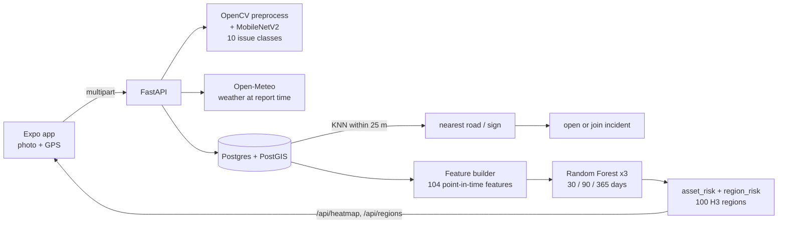

# CityWatch: city infrastructure risk

CityWatch lets residents report infrastructure problems with a photo. It then
classifies each report automatically, ties it to the physical asset it affects,
and forecasts **where failures are likely next**, so crews can be sent there
before things break. Built at HackCanada 2026, then rebuilt into a tested,
reproducible system.

<!-- METRICS:START -->
| | Result | How it's measured |
|---|---|---|
| Risk forecast, 30 days | ROC-AUC **0.759**. Inspecting the top 10% of assets catches **43%** of next-month failures, vs 31% when ranking by past incidents | 12 held-out monthly snapshots, time-based purged split |
| Risk forecast, 90 / 365 days | ROC-AUC **0.754** / **0.736** | same |
| Features | **104** point-in-time features per asset (own history, 50–500 m neighbourhood, citizen reports, H3 region, weather windows) | `test_no_future_leakage` |
| Feature pipeline | **0.39 s** per snapshot for 10.8K assets, **45× faster** than the original per-asset buffer scan (which computed only 4 features) | `scripts/bench_features.py` |
| Live rescoring | All 10,828 assets and 100 regions rescored in **~2–3 s** after each report | API logs |
| End-to-end report | Upload, weather, asset match and DB write in **~1.2 s** (CV model excluded) | local run |
| Image classifier | **89.8%** accuracy, **97.8%** top-2, macro-F1 **0.875** across 10 issue classes + `no_issue` (fine-tuned ImageNet MobileNetV2) | 2,798 held-out test images after near-duplicate removal (aHash, all flips/rotations) |
| Dataset cleaning | 48K raw photos from 3 Kaggle datasets; **58%** were augmented near-duplicates that would have leaked between train and test. 18.7K kept (largest classes capped at 3,000) | `ml/artifacts/cv_dataset.json` |

Risk results come from **simulated** failure history (see [Data](#data)). Weakest CV classes: `damaged_roads` (F1 0.76, confused with potholes), `no_issue` (0.70), `illegal_parking` (0.77, only 7 test images); full report and confusion matrix in [`cv_metrics.json`](backend/ml/artifacts/cv_metrics.json) / [`cv_confusion_matrix.png`](backend/ml/artifacts/cv_confusion_matrix.png).
<!-- METRICS:END -->

## How it works



1. **Report.** The app uploads the photo and GPS point to the API. The API then
   runs three things at once: classification, a weather lookup, and photo storage.
2. **Classify.** The same OpenCV code used in training (decode, square crop,
   resize) prepares the photo. A fine-tuned MobileNetV2 predicts one of 10
   issue types. Severity comes from Gemini if a key is set, otherwise from a
   transparent heuristic.
3. **Link.** PostGIS finds the nearest real OpenStreetMap road segment or sign
   within 25 m. If that asset already has an open incident, the report joins it
   (de-duplication). Otherwise a new incident is opened.
4. **Forecast.** After each new report, a debounced background job recomputes
   features for all ~10.8K assets and scores them. The heatmap updates within
   seconds.
5. **Act.** Staff move reports through `open → in_progress → resolved / rejected`.
   An incident closes when none of its reports are still open.

## Data

| Data | Source | Real or simulated |
|---|---|---|
| 3,776 road segments, 7,052 signs/crossings/signals | OpenStreetMap (Waterloo, ON) | Real |
| Daily weather 2019 to present | Open-Meteo archive | Real |
| ~11K incidents + ~24K citizen reports (2020 to present) | `ml/risk/simulate.py` | **Simulated** (`is_simulated = true`) |
| Labelled photos, 10 issue classes + no-issue | Kaggle Urban Issues Dataset + two pothole/road-issue datasets | Real |

No public per-asset failure history exists for Waterloo, so failures are
**simulated** with a daily hazard process. Its inputs are real asset attributes
(road class, segment length), spatial hotspots, **real** freeze-thaw and
precipitation history, ageing, and self-excitation. Report volume scales with
severity, and about 12% of reports are noise. The risk-model metrics below are
therefore results on simulated data, and should be presented that way.

## Risk model evaluation

- **Point-in-time features.** Each feature for snapshot *S* uses only events
  before *S*. A unit test (`test_no_future_leakage`) enforces this.
- **Time-based, purged split.** The last 12 monthly snapshots are the test set.
  Training snapshots for horizon *h* must end *h* days before the test period,
  so no training label overlaps it.
- **Baselines.** (a) Rank assets by their incident count over the past year.
  (b) The same forest using only the ~14 features the hackathon model had.

Full numbers: [`backend/ml/artifacts/risk_metrics.json`](backend/ml/artifacts/risk_metrics.json),
also served at `GET /api/model`.

## Run it locally

Prerequisites: Python 3.13, Node 22, and Postgres 16+ with PostGIS
(`brew install postgresql@18 postgis`, or `docker compose up db`).

```bash
make setup                      # venv + npm install
createdb citywatch
cp backend/.env.example backend/.env
make bootstrap                  # migrate, load OSM + weather, simulate, train risk, score
make api                        # http://localhost:8000/docs
make app                        # Expo (set frontend/.env from frontend/.env.example)
```

Train the image classifier. This needs a Kaggle API token, and the download is ~5 GB:

```bash
make train-cv
```

### Environment

| Variable | Where | Purpose |
|---|---|---|
| `DATABASE_URL` | backend | Postgres/PostGIS (local or Supabase connection string) |
| `SUPABASE_URL`, `SUPABASE_KEY` | backend | Optional photo storage (otherwise saved to `backend/uploads`) |
| `STAFF_API_TOKEN` | backend | Shared secret for status changes and risk refresh |
| `GEMINI_API_KEY` | backend | Optional LLM severity scoring |
| `EXPO_PUBLIC_API_URL` | app | API base URL reachable from the device |
| `EXPO_PUBLIC_MAPBOX_TOKEN` | app | Public Mapbox token |
| `EXPO_PUBLIC_AUTH0_DOMAIN`, `EXPO_PUBLIC_AUTH0_CLIENT_ID` | app | Login |

## API

| Method | Path | Notes |
|---|---|---|
| POST | `/api/reports` | multipart: `file`, `latitude`, `longitude`, `photo_timestamp?`, `user_id?` |
| GET | `/api/reports` | filters: `user_id`, `status`, `h3_cell`, `limit`, `offset` |
| GET | `/api/reports/{id}` | includes weather snapshot |
| PATCH | `/api/reports/{id}/status` | staff (`X-Staff-Token`) |
| GET | `/api/stats` | active, resolved this week, median days to resolve, type breakdown |
| GET | `/api/heatmap?period=current\|30d\|90d\|365d` | one point per H3 region |
| GET | `/api/regions?horizon=30d` | GeoJSON hexagons for a choropleth |
| GET | `/api/regions/top`, `/api/regions/{h3}` | ranked regions; riskiest assets + open reports |
| GET | `/api/leaderboard?window=30d` | top reporters |
| GET | `/api/model` | evaluation metrics of the deployed models |
| POST | `/api/admin/risk/refresh` | staff; rescore now |

## Repository layout

```
backend/
  app/            FastAPI app (routers, services: classifier, weather, storage, severity, risk)
  db/             SQL migrations + runner
  ml/cv/          OpenCV preprocessing, dataset prep, MobileNetV2 training
  ml/risk/        simulator, feature builder, training
  ml/artifacts/   trained CV model + metrics (risk model is rebuilt by `make train-risk`)
  scripts/        OSM ingestion, weather backfill, feature benchmark
  tests/          unit + API integration tests (real PostGIS)
frontend/         Expo / React Native app
docs/PRODUCT.md   problem, users, scope, metrics, decisions, roadmap
```

## Tests

```bash
make test     # 26 tests: features (incl. leakage), services, API against PostGIS
make lint     # ruff + tsc + expo lint
```

CI runs both on every push and PR (GitHub Actions, PostGIS service container).

## License

GPL-3.0; see [LICENSE](LICENSE).
